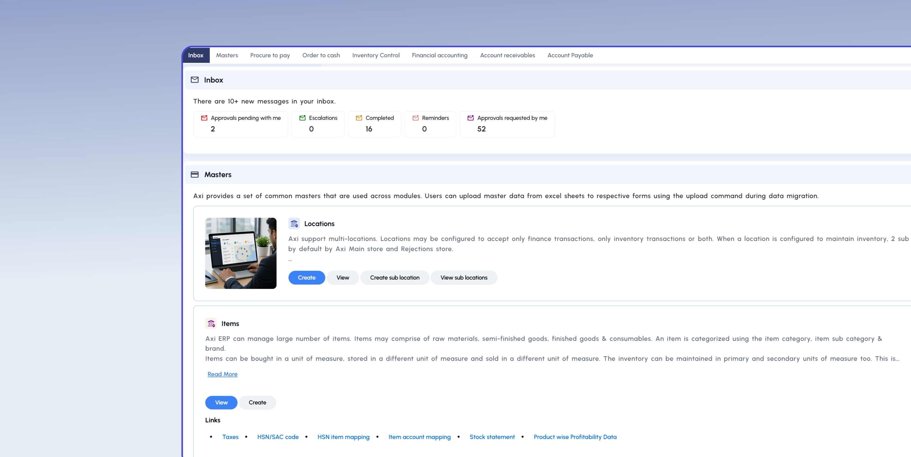
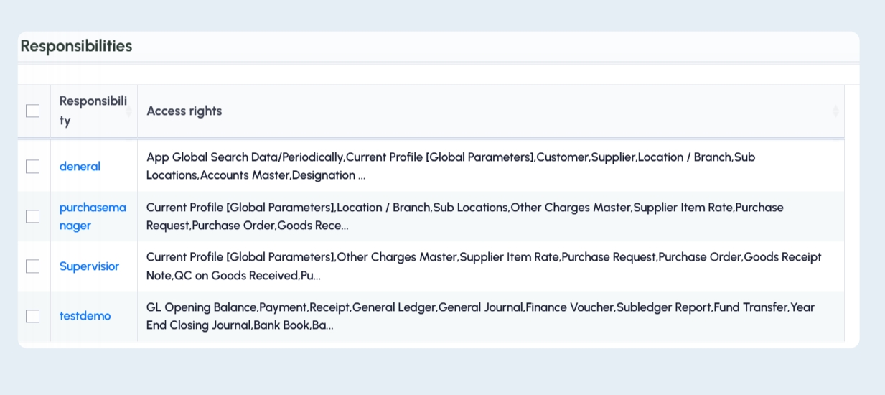
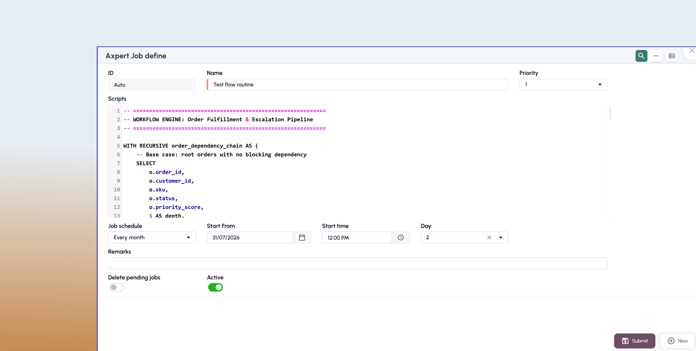
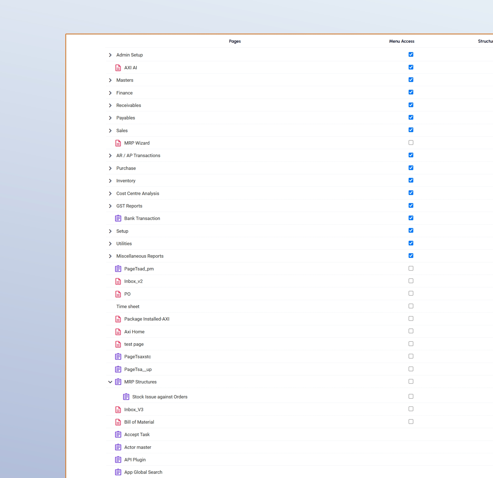
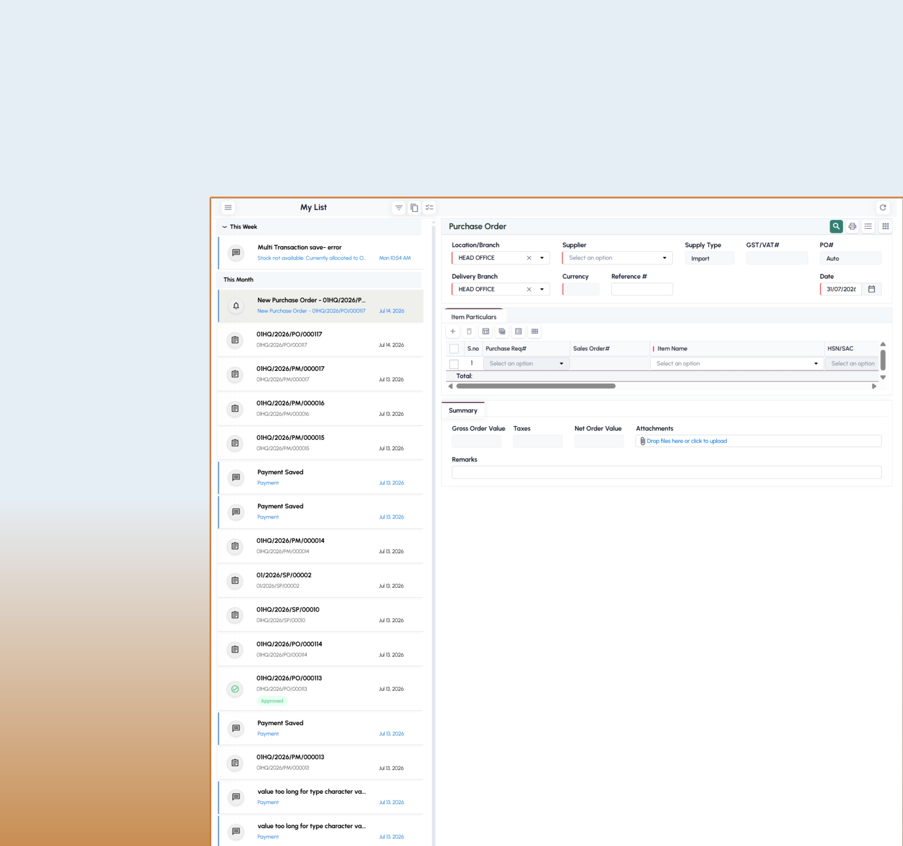
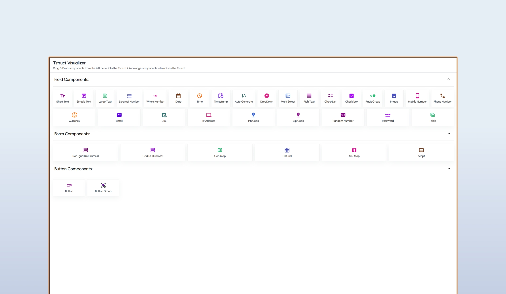

# Axpert: Frontend Work Showcase

Screenshots and a skills summary from my frontend work on **Axpert**, the low-code / RAD enterprise platform from Agile Labs, where I work as a Frontend Developer.

> This repo contains **screenshots only**. The source code is proprietary to Agile Labs and is not published here.

## What I work on

- **Interaction-heavy product and marketing UI**: React, TypeScript and Tailwind, including a draggable Three.js deployment globe, animated bento grids and wired-diagram visualisations.
- **Enterprise dashboard and form UIs**: KPI cards, charts, data grids, role-based menus and notification lists.
- **AI analytics chat interface**: a conversational assistant over business data, with provider selection, prompt templates and a data-source picker.
- **Content-heavy sites**: a prerendered, searchable developer-guide knowledge base.

**Stack:** React · TypeScript · Tailwind CSS · Three.js · Node.js · Prisma · PostgreSQL · Docker

## Screenshots

All screens use demo data.

| | |
|---|---|
|  **Role-based home dashboard** |  **Responsibility and access-rights management** |
|  **Scheduled job definition with a script editor** |  **Menu and page access configuration** |
|  **Inbox-style list with a transaction form** |  **Drag-and-drop form builder** |

## Related

- [AXI AI showcase](https://github.com/smooth-glitch/AXI-AI-showcase): the AI analytics chat dashboard
- [About me](https://github.com/smooth-glitch)
